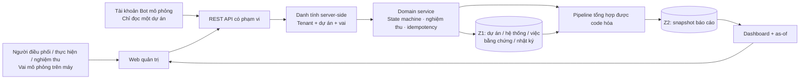
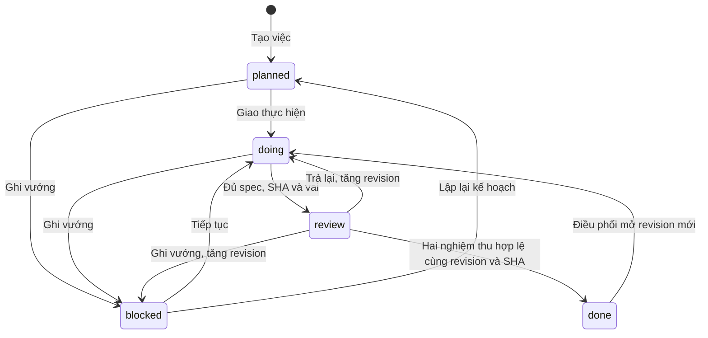
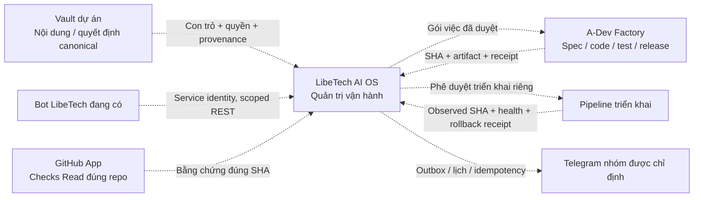

# LibeTech AI OS — thành phần và luồng

## Thành phần đã hiện thực ở foundation

PGlite chạy PostgreSQL SQL trong tiến trình local; schema có RLS bắt buộc và context được đặt trong transaction dưới role không bypass. Thử nghiệm concurrency ở đây không thay thế kiểm PostgreSQL server/connection pool.

Mọi ghi nghiệp vụ từ người dùng đi qua domain service. Bot không được gọi tạo việc, chuyển trạng thái, nghiệm thu hoặc làm mới projection. Pipeline là bộ xử lý xác định của nền tảng, không phải AI/LLM. Chưa có Z4 vì chưa có pipeline AI; khi bổ sung, AI chỉ tạo đề xuất Z4 để người có quyền quyết định.

## Luồng nghiệm thu

- Technical acceptance: người được giao, khác người làm, bằng chứng `checks` hoặc `release` đúng revision/SHA, xác nhận trực tiếp tiêu chí.
- Business acceptance: người được giao, khác người làm, bằng chứng `uat` đúng revision/SHA, xác nhận trực tiếp tiêu chí.
- `close_ticket`: sự kiện độc lập; không đổi state, không tạo nghiệm thu, không gọi hệ thống nguồn.
- Thay đổi hồ sơ hoặc trả lại từ review làm mất hiệu lực của xác nhận cũ; lịch sử và bằng chứng cũ không bị sửa.
- Hai yêu cầu đồng thời cùng version: chỉ một được commit. Lặp cùng key/nội dung: trả kết quả cũ, không phát sinh sự kiện mới.

## Đích kết nối, CHƯA triển khai

GitHub App là danh tính máy có quyền hẹp để đọc Checks. Nó không thay người nghiệm thu, không chứng minh phiên bản đã chạy trên gateway và không tự triển khai. Việc kế thừa App hiện có phải xác minh quyền/repo/cách lưu khóa trước khi kết nối; foundation không đọc khóa hoặc cấu hình bot cũ.

Vault vẫn sở hữu tri thức/quyết định; GitHub sở hữu code; Factory sở hữu tiến trình build; hệ thống nghiệp vụ sở hữu giao dịch; AI OS quản lý điều phối, thẩm quyền, hồ sơ và quan sát vận hành theo cutover được duyệt. Không truy DB của nền tảng khác.

## Dữ liệu và nguồn sự thật

| Entity | Foundation | Trước khi dùng thật |
|---|---|---|
| Project / service / work | Chỉ fixture tổng hợp | Đối soát mã nguồn, owner, bảng việc và ánh xạ; không tự thay bảng team |
| Evidence | Link khai báo + source ID/type/SHA/time/quality | Adapter GitHub/Vault có quyền, freshness, hash và receipt |
| Acceptance | Sự kiện thủ công có người/phiên bản | Giao quyền thật theo từng dự án, xác nhận UAT |
| Audit | Append-only local | Retention, export, chống can thiệp admin và restore |
| Summary | Z2 snapshot | Worker ETL và freshness SLO |
| Service observation | UNKNOWN | Nguồn runtime thật; desired khác observed |

## API v1

Tất cả phản hồi `{data,error,meta:{requestId}}`. List/detail áp dụng cùng tenant/project scope; không tồn tại hoặc ngoài phạm vi trả 404, không lộ metadata. Identity chỉ lấy từ session server; body chứa `actorId` hoặc `tenantId` ngoài schema bị từ chối.

| Endpoint | Quyền / hành vi |
|---|---|
| `GET /api/v1/workspace` | Snapshot scoped cho web |
| `GET /api/v1/overview` | Tổng hợp Z2 có thời điểm |
| `GET /api/v1/services` | Danh mục scoped |
| `GET /api/v1/work` | Danh sách scoped, tối đa 200 việc ở slice này |
| `GET /api/v1/work/:id` | Việc, bằng chứng, sự kiện, nghiệm thu hiện hành |
| `POST /api/v1/work` | Điều phối; Idempotency-Key; schema nghiêm |
| `POST /api/v1/work/:id/commands` | Người có quyền; expectedVersion + Idempotency-Key |
| `POST /api/v1/overview/refresh` | Điều phối kích hoạt pipeline Z2 |
| `POST /api/demo/session` | Local-only, synthetic, không phải production identity |
| `DELETE /api/demo/session` | Hủy phiên local |
| `GET /api/health` | Phiên bản ứng dụng, schema, storage, trạng thái tích hợp |

Giới hạn danh sách 200 được coi là giới hạn của demo, chưa đủ cho quy mô thật; pagination/filter backend thuộc lát tiếp theo. Không có cron tự gửi, không xuất dữ liệu ra bên ngoài.
