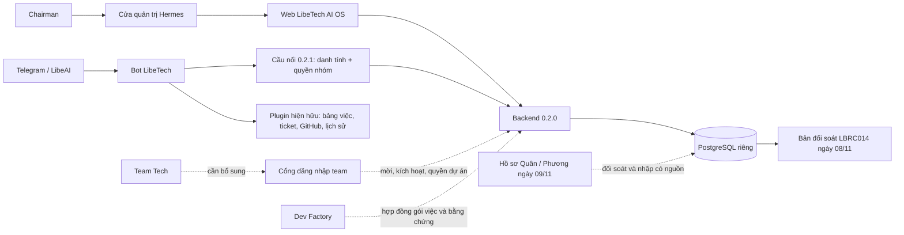

# Resume LibeTech AiTogether / AI OS và bot — 09/11/2026

Phạm vi: kiểm nền tảng mới, các luồng/dữ liệu đã triển khai và khả năng Team Tech đăng nhập. Đo server lúc 15:36–15:37 giờ Việt Nam qua Hermes, chỉ đọc. Đây là bản cập nhật trạng thái và thứ tự bổ sung; không phải biên bản nghiệm thu toàn bộ AI OS.

## Kết luận

**Team Tech chưa có tài khoản đăng nhập vào nền mới.** Truy vấn toàn bộ `identity.users` trên d1-ai1 trả duy nhất `chairman`: đang hoạt động, đã kích hoạt, đã ghép Telegram, có một dự án. Không có lời mời còn hiệu lực. Nguồn: [quan sát server](RESUME-SERVER-OBSERVED-20261109.json), các trường `users`, `counts.openInvites`, `identityObservedAt`.

Nền mới đang trả lời với PostgreSQL và backend 0.2.0; gateway báo 20/20 kết nối Telegram lúc 15:37. Kết nối không chứng minh mọi nghiệp vụ của 20 bot. Nguồn: [quan sát server](RESUME-SERVER-OBSERVED-20261109.json), `portalObservedThisSession` và `gateway`.

## Những gì đã có — và giới hạn

| Thành phần / luồng | Đã có bằng chứng | Giới hạn hiện tại | Nguồn |
|---|---|---|---|
| Nền web + PostgreSQL riêng | Server trả lời 0.2.0; truy vấn DB thành công | Vẫn là pilot, không phải toàn bộ vận hành LibeTech | `RESUME-SERVER-OBSERVED-20261109.json` |
| Đăng nhập tài khoản tổ chức | `chairman` đã kích hoạt và ghép Telegram | Chưa có người dùng Team Tech | Cùng biên nhận, `users` |
| Web → Telegram → dữ liệu theo quyền | 09:22 hôm nay: LibeAI đọc đúng LBRC014/full SHA; Libe–Xeca nhận `SCOPE_DENIED` | Đây là phép thử thật buổi sáng, không phải lần phát lệnh mới lúc 15:36 | `TELEGRAM-GROUP-VERIFICATION-20261109T0922.json` |
| Bot công cụ hiện hữu | Mã priority1 1.1.4 có đọc/ghi bảng việc, danh bạ, lịch sử, GitHub và mở/cập nhật/liệt kê ticket | Tách khỏi bridge AI OS; đọc mã không chứng minh bản đang nạp hoặc mọi thao tác đã UAT | `../../libe-tech/hermes-libetech-priority1/plugin/__init__.py:709` |
| Báo cáo tuần | Biên nhận 06/11 ghi lịch 16:00 tự chạy, gửi LibeAI 16:01:02, mã tin 689 | Không kiểm lại cron hôm nay; không suy diễn người nhận đã đọc | `../../libe-tech/hermes-libetech-priority1/WEEKLY-AUTO-VERIFICATION-20261106.md:3` |
| Công việc / bằng chứng / nghiệm thu | Mã nền mới có phân quyền, SHA + revision, sự kiện kỹ thuật và nghiệp vụ độc lập | DB thật còn 0 công việc, 0 bằng chứng; portal hiện chỉ mở các đường đọc, đăng nhập, đăng xuất, ghép Telegram | `../src/server/service.ts`; `../dashboard-plugin/dashboard/plugin_api.py:26`; biên nhận server |

`SCOPE_DENIED` của cầu nối AI OS khác `GITHUB_SCOPE_DENIED` của công cụ GitHub hiện hữu. GitHub App chỉ phục vụ quyền đọc Checks cho repo được duyệt; không tạo tài khoản web cho team, không chứng minh triển khai hoặc nghiệm thu. Nguồn: `TELEGRAM-GROUP-VERIFICATION-20261109T0922.json`, `limitations`; mã `../../libe-tech/hermes-libetech-priority1/plugin/__init__.py:712` và cấu hình phạm vi Checks trong plugin.

## Dữ liệu thực sự có trên nền mới

| Dữ liệu | Số lượng đo lúc 15:36 |
|---|---:|
| Tài khoản | 1: chairman |
| Dự án | 1 |
| Dịch vụ / hệ thống | 0 |
| Công việc quản trị | 0 |
| Bằng chứng trong sổ mới | 0 |
| Sự kiện nghiệp vụ công việc | 0 |
| Lời mời chưa dùng, còn hiệu lực | 0 |
| Bản đối soát đọc | 1: LBRC014 |

Nguồn toàn bảng: `RESUME-SERVER-OBSERVED-20261109.json`, `users`, `counts`, `reconciliations`.

LBRC014 trong DB vẫn là bản đối soát nạp ngày 08/11 với SHA `8d05141576bcd4db8e7ab9f1a6b7a0dd9bd360ab` và snapshot hash `4f8aaa43dce649ec6ea6224e91120939c0b4a20125688e4f61f26d536db34b48`. Chưa phải công việc đã chuyển sang nguồn quản trị mới. Các báo cáo/ZIP bổ sung của Quân và Phương ngày 09/11 nằm trong hồ sơ đối soát địa phương; không coi bot đã tự đọc các bổ sung đó qua AI OS. Nguồn: biên nhận server trên; [biên bản LBRC014](LBRC014-BIEN-BAN-NGHIEM-THU-20261109.md), mục 12; `lbrc014-supplements-20261109/phuong-ios-1502-inspection.json`.

Không có bằng chứng trong lần kiểm này rằng DB AiTogether cũ đã được chuyển sang nền mới. Kế hoạch kế thừa vẫn giữ dữ liệu cũ và bảng việc của team ở nguồn hiện hữu. Nguồn: `IMPLEMENTATION-ROADMAP.md`, mục “Kế thừa từ AiTogether”; biên nhận server chỉ chứa một bản đối soát.

## Sơ đồ luồng hiện tại và phần cần nối

Nét liền: đường đã có mã/biên nhận như bảng trên. Nét đứt: phần đề xuất bổ sung, chưa triển khai. Sơ đồ tổng hợp từ `PORTAL-DEPLOY-20261108.md`, `dashboard-plugin/dashboard/plugin_api.py`, `src/server/identity.ts` và biên nhận server.

## Vì sao chỉ tạo thêm tên đăng nhập vẫn chưa đủ

1. **Đường vào hiện đi qua Hermes admin.** Portal gọi `_require_token` của Hermes trước khi chuyển tiếp; không đưa tài khoản quản trị Hermes dùng chung cho team. Cần cổng team chỉ phục vụ AI OS, hoặc cơ chế admission người dùng riêng đã được kiểm chứng. Nguồn: `../dashboard-plugin/dashboard/plugin_api.py:36`.
2. **Kích hoạt chưa đi hết tới người mới qua portal.** Backend có `activate`, nhưng allowlist portal hiện chỉ có health/me/workspace/login/logout/telegram-code. Nguồn: `../src/server/auth-http.ts:10`; `../dashboard-plugin/dashboard/plugin_api.py:26`.
3. **Chưa có luồng quản trị tài khoản tổng quát trong các thành phần đã rà.** Script pilot cấp chairman; chưa có API/UI mời thành viên, sửa quyền, vô hiệu hóa và thu hồi phiên cho quản trị viên. Nguồn: `../scripts/import-pilot.ts:14`; `../src/server/identity.ts:64`; `../src/server/auth-http.ts:10`.
4. **Quyền hiện mới có vai ở tài khoản và danh sách dự án.** Nếu một người làm developer ở dự án này và người duyệt ở dự án khác, cần mô hình quyền theo dự án trước khi dùng rộng. Không mặc định Quân hoặc Phương có quyền nghiệm thu nghiệp vụ. Nguồn: `../src/server/types.ts:1`; `../src/server/identity.ts:39`; `../migrations/002_identity.sql`.

## Thứ tự bổ sung đề xuất

| Thứ tự | Gói việc | Điều kiện đạt |
|---|---|---|
| 1 | Cổng dành cho Team Tech, dùng username/password theo lựa chọn của Chairman | Thành viên vào AI OS mà không cần quyền quản trị Hermes; giữ backend/DB kín; lối vào và phạm vi công bố được duyệt trước khi mở |
| 2 | Mời tài khoản, kích hoạt một lần, giao dự án/vai, vô hiệu hóa và thu hồi phiên | Không lộ mật khẩu/mã mời; người dùng tự đặt mật khẩu; chặn nâng quyền, hết hạn, dùng lại mã; audit đầy đủ |
| 3 | Onboard Quân, Phương và danh sách được giao | Chốt đúng người, tên đăng nhập và phạm vi dự án; từng người tự đăng nhập, ghép Telegram riêng; chứng minh đọc được phần được giao và bị chặn phần ngoài quyền |
| 4 | Đưa LBRC014 vào cơ chế bằng chứng có nguồn | Nhập bổ sung như bản quan sát mới, giữ bản cũ/hash; nối đúng SHA/revision; tách phần đủ và thiếu; không tự đổi trạng thái bảng việc hay tự nghiệm thu |
| 5 | Nối báo cáo và các nguồn hiện hữu | Bot/web cùng đọc bản đối soát có thời điểm; kế thừa lịch và nhóm đã duyệt, có biên nhận gửi; chưa tạo lịch mới |
| 6 | Vận hành hệ thống và Dev Factory | Service inventory, sự cố, thay đổi, release/deployment thực tế, backup/restore; sau đó nhận gói việc/bằng chứng từ Factory |

Đây là đề xuất triển khai tiếp từ khoảng trống đã đo, không phải thông báo các tính năng đã cài. Phạm vi nền và roadmap: `../AGENTS.md:4`, `IMPLEMENTATION-ROADMAP.md`.

## Bảo toàn và phương pháp kiểm

Lần này chỉ kiểm portal, truy vấn SELECT có `default_transaction_read_only=on`, đọc metadata gateway và mã/tài liệu local. Không tạo tài khoản, sửa quyền, nhập dữ liệu, sửa bảng việc, gửi tin hay khởi động lại. Các phép kiểm trực tiếp được ghi ở `RESUME-SERVER-OBSERVED-20261109.json:46`; hồ sơ Telegram buổi sáng giữ riêng.

Hermes từ chối lệnh Python inline; phần kiểm đã hoàn tất bằng truy vấn SQL chỉ đọc cụ thể và đọc metadata bằng jq, không thay đổi cơ chế bảo vệ. Kết quả server trong biên nhận là bản chép các trường nhìn thấy trên UI, không gọi là xuất DB thô. Không lưu mật khẩu, mã ghép hoặc token. Nguồn phương pháp: `RESUME-SERVER-OBSERVED-20261109.json:59`; phạm vi trường đã lưu: `RESUME-SERVER-OBSERVED-20261109.json:1`.
