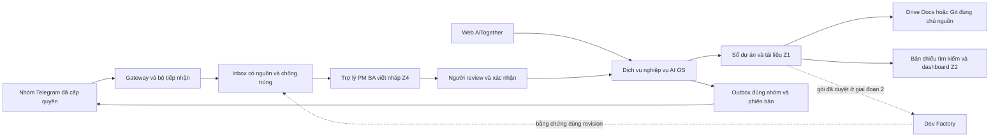

# SPEC 009 Quản lý dự án và tài liệu qua AiTogether

## 1 Kết luận và phạm vi

Ưu tiên giai đoạn 1 là năng lực PM/BA và vòng đời tài liệu: tiếp nhận nhiều nhóm được cấp quyền, làm rõ yêu cầu, lập kế hoạch, soạn và review tài liệu, xác nhận phiên bản, chia sẻ đúng người, theo dõi kết quả. Giai đoạn 2 kết nối Dev Factory bằng gói yêu cầu đã chốt và bằng chứng đầu ra có phiên bản. Jira cũ chỉ là nguồn ví dụ; di trú Jira không nằm trên đường găng.

**Phương án đề xuất:** giữ Drive/Docs của team để cộng tác nghiệp vụ, Git của từng dự án cho tài liệu kỹ thuật; bổ sung sổ tài liệu và quy trình quyết định trong AI OS, dùng bot làm cửa tiếp nhận và trợ lý viết. Một tài liệu chỉ có một nguồn nội dung chính; AI OS giữ định danh, liên kết, trạng thái xác minh và bản chuẩn đã duyệt. Không xây lại trình soạn thảo cộng tác trong lát đầu. BookStack là phương án tự vận hành cần thử nếu Drive không đáp ứng; Docmost cần tính đến bản thương mại cho API/quyền nâng cao.

SPEC này **extends** [SPEC-008](SPEC-008-PM-operating-loop-20261111.md), ưu tiên nội dung và thứ tự ở đây khi khác §13/15 của SPEC-008. Kế thừa [DOC-CONTRACT](../../libe-tech/hermes-libetech-priority1/DOC-CONTRACT-PROPOSAL-20261106.md); không sửa quy định canonical. [ADR-002](ADR-002-project-document-ownership.md) đề xuất chủ dữ liệu mới; chưa phải quyết định đã ký hoặc đã triển khai.

## 2 Hiện trạng đã đối chiếu

| Nguồn | Điều kiểm được ngày 11/11 | Phần cần kế thừa hoặc sửa |
|---|---|---|
| `../src/server/types.ts:13`, `service.ts:17`, `bridge.ts:11` | Work có spec_url và source_sha; bằng chứng có spec/checks/release/uat; bridge hiện đọc đối soát, ghép danh tính, duyệt tài khoản | Giữ quyền và audit; thêm registry tài liệu, revision/approval và thao tác bot hẹp. Không coi link spec là một hệ quản lý tài liệu |
| `../../ai-together/supabase/schema.sql:39`, `:89`, `:113` | AiTogether cũ có project_rules, deliverables, file links, reviews | Tái dùng khái niệm tài liệu theo dự án/đầu ra và review. Cột version đơn lẻ không thay lịch sử bất biến |
| `../../ai-together/app/projects/[id]/page.jsx:336` | Upload tệp xong gọi chuyển checklist sang done ở dòng 348 | Thiết kế mới giữ tách nộp tệp, đọc được, review, duyệt và nghiệm thu |
| `../../ai-together/app/api/files/route.js:33` | Khi upload lỗi, đường fallback vẫn ghi tham chiếu tệp; nhánh thành công lấy public URL ở dòng 63 | Bản mới phải có receipt lưu blob thật và kiểm quyền tải; không kế thừa hành vi này. Chưa kiểm cấu hình storage/runtime cũ, không kết luận đã lộ tệp |
| Bot `plugin/lanes.py:1` | Nhóm mới mặc định customer/UNKNOWN, chưa tự được cấp BU | Giữ mặc định; thêm đăng ký nhóm/topic → project, trạng thái quyền và bằng chứng nhận tin thực tế |
| [Bảng việc hiện tại](https://docs.google.com/spreadsheets/d/1Vr1ykZUtwm5Wvj1oAQRjpzMgleDa6Fhu-WiPv-L61Vc/edit#gid=1963754558) | Đọc lại 45 dòng; nguồn modified 2026-11-11T04:23:09.206Z. STT41/XECA006 đang triển khai; STT30/LBRC014 hoàn thành theo team | Chỉ dùng làm hiện trạng và ca đối chiếu; không đổi status, owner hay hạn của nguồn |

Đây là kiểm mã local, nguồn Drive hiện tại và hồ sơ đã lưu. Không đo lại server/gateway, không đọc toàn bộ lịch sử các nhóm. Số tài khoản đăng nhập thực tế và lượng tin/ngày chưa đo; thiết kế thử với nhóm Tech nhỏ hiện có, không giả định quy mô lớn.

## 3 Người và nhiệm vụ

Phương phụ trách PM chung, điều phối/vận hành và Liberico; Quân phụ trách kỹ thuật, code, hạ tầng và maintenance; Chu Hoàng Anh phụ trách IBS HI, chuyển đổi số thành viên BTNET/MRO và phối hợp BTNET. Đây là phạm vi theo chỉ đạo; người review/duyệt tài liệu cụ thể phải có delegation theo dự án. Tác giả không tự nghiệm thu đầu ra mình làm.

| Thao tác | Bot/AI | Người có quyền | Hệ thống ghi |
|---|---|---|---|
| Nhận tin/tệp | Ghi nguồn, trả receipt, hỏi thiếu, đề xuất loại | Người báo sửa mô tả nếu cần | Source event và ứng viên intake |
| Viết/làm rõ tài liệu | Soạn nháp, dẫn nguồn, đánh dấu giả định | BA/PM hoặc tác giả xác nhận nháp | Bản nháp Z4; sau lệnh xác nhận, domain service ghi revision nghiệp vụ |
| Review tài liệu | So tiêu chí, nguồn mâu thuẫn, phần thiếu | Reviewer được giao nhận xét | Comment gắn revision, trạng thái xử lý |
| Duyệt bản chuẩn | Tóm tắt thay đổi và tác động | Chủ nội dung/BU/tech reviewer theo loại | Approval gắn đúng revision/hash; không suy từ “đã đọc” |
| Chia lại việc | Soạn đề nghị, nhắc người thiếu phiếu | BoM Chu–Quân–Phương 3/3 | Phiếu cùng version và receipt áp dụng |
| Cập nhật tiến độ | Nhận khai báo của người làm | Người được giao xác nhận | Event thường ngày không phải xin lại 3/3 |
| Chia sẻ ra nhóm | Soạn bản phù hợp phạm vi | Người được quyền công bố hoặc chính sách đã duyệt | Bản công bố, audience, receipt giao và phản hồi riêng |

Duyệt tài khoản Chairman + 1 BoM vẫn là luồng riêng. Duyệt một tài liệu không tự duyệt chi phí, giao người hoặc lịch triển khai. Chưa có quyền rõ thì hiển thị Chờ xác định người duyệt, không tự dồn mọi việc về Chairman.

## 4 Thành phần và chủ dữ liệu

| Loại dữ liệu | Chủ nội dung | AI OS giữ gì | Quy tắc |
|---|---|---|---|
| Tin Telegram | Nhóm/source event được nhận | Tin cần thiết hoặc trích được phép, locator và receipt | Chat ID/topic lấy từ gateway; không nhận quyền từ nội dung |
| Tài liệu nghiệp vụ hiện có | Drive/Docs/Vault và người giữ nguồn | Pointer, revision nguồn, hash bản xuất, owner, classification | Không mirror toàn Vault hoặc tự đổi share |
| Spec/API/runbook kỹ thuật | Repo của thành phần | Pointer ghim commit và tài liệu liên quan | Ghi vào repo qua PR do người có quyền áp; không push bằng service principal đọc |
| Bản chuẩn đã duyệt | Nội dung ở nguồn; quyết định áp dụng ở AI OS | Revision bất biến + hash + approval + manifest | “Latest draft” và “current approved” là hai con trỏ khác nhau |
| Work/decision/approval/links | AI OS theo ADR-002 | Z1 qua domain service; event bất biến | Kế thừa expected version, idempotency và RLS |
| Tìm kiếm/dashboard | Projector Z2 | Chỉ mục/project-scoped projections | Không truy vấn Z1 nền khác; kiểm quyền trước truy xuất, trước trả lời và lúc gửi |
| Gợi ý của AI | Z4 | Draft, confidence, nguồn và phần cần hỏi | Không tự ghi quyết định vào Z1/Z2 |

Với Google Docs đang thay đổi, snapshot xuất phải lưu bất biến đúng quyền và gắn approval. RevisionId từ nguồn khi có; hash xác định bytes đã xem, không suy hash là danh tính người duyệt. Nếu không giữ được bản chuẩn để truy lại, trạng thái là chưa đóng băng được, không hiển thị “đã duyệt bản hiện tại”. Snapshot chứng cứ không trở thành nguồn soạn thảo thứ hai.

Riêng nguồn riêng của IBS HI tiếp tục giới hạn con trỏ/hash/metadata việc Tech; không dùng yêu cầu snapshot để tự cache toàn văn. Chỉ bản trích Tech được chủ nguồn cho phép mới vào kho snapshot LibeTech; nếu chưa có quyền, bản gốc giữ ở nguồn và hồ sơ báo rõ giới hạn kiểm chứng.

## 5 Nhận nhiều nhóm và tổng hợp có kiểm soát

1. Khi bot được thêm vào nhóm, ghi nhận pending registration. Chủ dự án/quản trị xác nhận chat ID, topic, BU, các project/service được phép, PM tiếp nhận, loại tin được xử lý và phần được công bố. Nhóm UNKNOWN không được đọc danh mục nội bộ hoặc phát sinh task có cam kết.
2. Thiết lập chế độ: chủ động tiếp nhận các tin gateway thực sự nhìn thấy, hoặc chỉ nhận lệnh/reply. Theo [Telegram FAQ](https://core.telegram.org/bots/faq#what-messages-will-my-bot-get), bot admin hoặc tắt privacy mode có phạm vi nhận tin rộng hơn; không suy cứ add bot là đọc được mọi trao đổi. Privacy mode là cấu hình bot ảnh hưởng nhiều nhóm, phải rà tác động toàn bộ trước khi đổi; quyền admin nếu cần chỉ cấp tối thiểu. Xác minh bằng tin thường, reply, tệp và topic ở từng nhóm.
3. Với chế độ chủ động đã duyệt: AI đề xuất yêu cầu/decision/doc update từ tin mới; bỏ small talk, gộp theo thread/time window, giới hạn thông báo. Không gọi mọi trao đổi là việc đã giao. Mốc bắt đầu thu nhận và khoảng thiếu lịch sử hiển thị rõ; Bot API không cung cấp một đường tổng quát để lấy toàn bộ chat cũ. Export được cấp quyền có thể nhập riêng, không giả làm sự kiện live.
4. Ghi bền nguồn trước khi ACK. Kèm source_id/type/ingested_at/quality_score, message_id, edit_date, chat/topic, actor nguồn, source hash và correlation. Một update lặp dùng cùng khóa; tin sửa tạo revision; album giữ các phần và đủ/tạm thiếu. Forward giữ mức xác minh nguồn, không mặc nhận người forward là tác giả/approver.
5. Bot hỏi ngắn đúng phần thiếu. Người báo ngoài team không cần tài khoản Tech để intake; quyền tạo work/duyệt cần tài khoản đã ghép và quyền project. Ví dụ: “Em ghi nhận nâng package. Đây là XECA006 hay việc khác?”; lựa chọn không tự làm hai việc trùng nhau.
6. Hệ thống gợi ý tài liệu liên quan, mức tài liệu cần có và bước tiếp theo. Gửi một bản tổng hợp vào nhóm phù hợp theo lịch đã duyệt, chỉ cảnh báo tức thời theo chính sách incident. Không tự thêm lịch cron hoặc nhóm nhận.

Các nhóm cùng BU nhưng khác dự án không tự chia sẻ mọi dữ liệu. Một thread liên quan nhiều dự án phải có PM đối soát trước khi fan-out; nội dung IBS HI chỉ phần Tech được cấp. Thu hồi membership phải chặn cả cache, search snippets, export, queued notification và link tải.

## 6 Bộ kỹ năng và tài liệu vừa đủ

Kế thừa mẫu quy trình từ BMAD/OpenSpec/arc42 có chọn lọc; chưa cài framework hoặc cho chạy mã. [Nghiên cứu repo](RESEARCH-PM-DOC-REPOS-20261111.md) ghi license và giới hạn. Sáu năng lực đề xuất, có đầu vào/đầu ra và phép kiểm riêng:

| Năng lực | Đầu vào | Đầu ra | Điều kiện kiểm |
|---|---|---|---|
| Intake analyst | Tin gốc, scope, catalog | Loại ứng viên, trùng/khác, câu hỏi thiếu | Không bịa hạn/người, không bỏ nguồn |
| BA elicitation | Nhu cầu, quy trình hiện tại, người dùng | User stories, quy tắc, acceptance, unknowns | Tiêu chí quan sát được; mâu thuẫn không bị che |
| PM planning | Phạm vi đã chốt, tải đã xác nhận, phụ thuộc | Plan/milestone, action, quyết định cần chốt | Ước lượng khác cam kết; chia người qua quyền hiện hành |
| Technical writer | Spec/API/code được đọc, mẫu theo loại | Bản nháp có nguồn, thuật ngữ, ví dụ | Không sinh endpoint/giới hạn giả; viết lại phần thay đổi |
| Doc reviewer | Hai revision và checklist | Diff nội dung, tác động tới test/hướng dẫn, phần thiếu | Không ký thay tác giả/reviewer; nêu phạm vi đã đọc |
| Release librarian | Revision được duyệt, bằng chứng, audience | Chỉ mục bản chuẩn, bản chia sẻ, nhắc stale | Không công bố draft/internal; không báo giao khi chỉ enqueue |

Mỗi kỹ năng cần manifest: tên/version/hash, sources/attribution, prompt, input/output schema, tool allowlist, data scope, owner và eval set. Nhóm kỹ năng chỉ nhận context đúng quyền; nội dung tệp và tin là dữ liệu không tin cậy, không thể cấp quyền tool. Trong pilot phải chạy cả ca bịa thiếu thông tin, injection trong tài liệu, nguồn xung đột, quyền bị thu hồi và cùng tên khác BU. Không sao chép quyền thực thi tự động của framework vào bot.

| Loại việc | Hồ sơ tối thiểu | Khi mở rộng |
|---|---|---|
| Sự cố/hotfix | Intake, impact, hành động khôi phục, cách kiểm, receipt, phần còn nợ | Postmortem/problem/runbook nếu lặp hoặc nghiêm trọng; không chờ PRD mới khôi phục |
| Bug nhỏ | Trước/sau, tái hiện, acceptance, kiểm hồi quy, bản giao | API/quyền/dữ liệu thay đổi thì thêm contract và migration |
| Nâng cấp kỹ thuật | Change brief, ma trận trước–sau, tương thích, kiểm/rollback, UAT liên quan | Nhiều repo/mobile thì thêm ma trận phiên bản và thứ tự phát hành |
| Tính năng | Brief/yêu cầu, user story/tiêu chí, thiết kế phần đổi, test/UAT, hướng dẫn | ADR chỉ khi đổi quyết định kiến trúc; không bắt ADR mọi bug |
| Sản phẩm mới | Product brief, PRD, roadmap, kiến trúc/phương án, pilot, vận hành | Baseline theo phase, chi phí và capacity do người có quyền chốt |
| Tài liệu/hỗ trợ | Hướng dẫn/biên bản có phiên bản, đối tượng dùng và ca dùng thử | Không ép Git SHA cho tài liệu thuần nghiệp vụ |

[Bộ mẫu](PM-DOCUMENT-TEMPLATES.md) có nội dung điền được cho từng loại; có thể gộp các mục trong một hồ sơ, không buộc tạo nhiều tệp hình thức.

## 7 Vòng cập nhật tài liệu

**Captured → Draft → In review → Approved baseline → Published to audience → Superseded/Archived.** Đây là vòng tài liệu, khác vòng task và nghiệm thu sản phẩm. Bản Approved còn hiệu lực trong lúc Draft kế tiếp đang sửa.

Tác giả gửi link hoặc cập nhật trực tiếp ở nguồn. Adapter đọc revision theo quyền, tạo delta và đánh dấu tài liệu phụ thuộc cần xem lại. AI đề xuất sửa dưới dạng nháp/patch, không ghi đè nội dung team. PM chọn tác giả/reviewer theo dự án. Reviewer nhận comment gắn đoạn và revision; có nút Chấp thuận/Yêu cầu sửa. Nội dung nguồn đổi trước khi vote được áp thì trả conflict, yêu cầu đọc lại; không áp phiếu vào bản mới chưa xem.

Domain service xác nhận quyền, lưu approval gắn revision/hash, rồi outbox công bố vào đúng nhóm. “Published” cần delivery receipt; đã giao khác người nhận đã xác nhận. Gửi link yêu cầu đăng nhập hoặc bản trích được duyệt cho khách; không tạo public link tự động. Tệp đính kèm Telegram đã gửi không có bảo đảm thu hồi khỏi máy người nhận, nên mặc định ưu tiên link có quyền cho tài liệu nội bộ.

Khi đổi yêu cầu, hệ thống chỉ ra task/test/hướng dẫn bị ảnh hưởng. Tác giả ghi cần sửa hay N/A kèm lý do; reviewer xác nhận. Thay phạm vi/hạn/người đi qua quyết định tương ứng; cập nhật chính tả không tự mở lại toàn dự án. Chủ nội dung đặt review_due_at theo độ rủi ro; dữ liệu quá hạn/mất quyền hiện rõ stale/unknown, không tự xóa hoặc duyệt lại.

## 8 Hợp đồng dữ liệu và API đề xuất

Tên dưới đây là thiết kế, chưa phải endpoint/schema đang tồn tại. Mọi bản ghi mới có UUID, tenant_id, project_id, TIMESTAMPTZ, version, RLS; truy vấn có tham số. API chỉ gọi domain service; analytics/search đọc projection có quyền. Không query DB của Drive/BookStack/Factory.

| Entity | Trường cốt lõi | Chủ ghi |
|---|---|---|
| SourceEvent | source_id/type, ingested_at, quality_score, locator, observed_at, content_hash, source_actor, chat/topic, edited_at | Bộ nhận sự kiện xác thực |
| ProjectChannel | chat_id/topic, BU/project allowlist, mode, enabled_from, approver, policy_version | Quản trị theo quyền |
| DocumentRecord | doc_id, project, type, title, content_owner, canonical_uri, classification, author/reviewer, latest_revision, approved_revision | Domain service |
| DocumentRevision | revision_id, source_revision, source_hash, source_modified_at, snapshot_ref, based_on, changes, status | Domain service từ thao tác đã xác nhận |
| ReviewDecision | revision/hash, actor/delegation, result, scope, exceptions, decided_at | Người review có quyền |
| TraceLink | requirement ↔ doc revision ↔ work ↔ test/evidence; link_type, confirmed_by | PM/người được quyền |
| Publication | revision, audience/scope, redaction_ref, outbox_id, delivered_at, receipt, ack_event | Domain service và outbox worker |

API dự kiến: `POST /api/intake-events` cho gateway đã ký; `POST /api/documents/register` cho thành viên; `POST /api/documents/:id/revision-proposals` nhận bản nháp; `POST /api/document-revisions/:id/reviews` ghi review; `POST /api/document-revisions/:id/approve` duyệt; `POST /api/document-revisions/:id/publications` công bố; `GET /api/projects/:id/documents` và `/api/search` đọc đúng phạm vi. Approval và publication yêu cầu actor từ phiên, expected_version, revision/hash và idempotency key. Bot relay dùng HMAC/timestamp/nonce và principal server-side; không nhận tenant/actor tùy ý trong body.

Giữ tách tuyến web công khai và cầu nối nội bộ đã thiết kế: endpoint tiếp nhận gateway chỉ được đăng ký trên listener nội bộ hoặc dưới namespace bridge bị proxy web chặn. `/api/intake-events` là tên hợp đồng logic, không phải yêu cầu mở route đó ra Internet. Mọi endpoint mới phải có phân loại web/bridge rõ trong allowlist proxy; kiểm từ bên ngoài bị chặn và từ gateway đúng quyền hoạt động. Không đổi bind backend hoặc mở cổng nội bộ để tiện tích hợp.

Các lỗi phân biệt: `SCOPE_DENIED`, `REVISION_CONFLICT`, `SOURCE_UNAVAILABLE`, `SOURCE_NOT_FROZEN`, `APPROVER_NOT_AUTHORIZED`, `EVIDENCE_INCOMPLETE`, `DELIVERY_PENDING`. Phản hồi không lộ tên/count dữ liệu ngoài quyền. Lỗi network retry có backoff và trần thử; lỗi quyền không retry vô hạn. Publish dùng outbox, trạng thái uncertain khi timeout sau gửi cần đối soát receipt trước gửi lại; không hứa exactly-once Telegram khi chưa có cơ chế chứng minh.

Bản gốc không bị xóa khi import lỗi. Attachment lưu private, giới hạn kích thước/loại, kiểm hash và đọc cách ly; không chạy macro/script. Search/OCR phải giữ ACL tới từng chunk và nguồn; prompt không thể bỏ qua ACL. Sổ lưu giữ/xóa có retention do chủ nguồn quyết trước pilot, gồm cả snapshot, embeddings và backups; chưa đặt mặc định “lưu vĩnh viễn”.

## 9 Hai ca đối soát thực tế

### 9.1 XECA006 đang triển khai

#fact từ bảng đọc lại 11/11: STT41 “Upgrade packages theo npm audit”, QuânTV, phối hợp ThắngNM, Đang triển khai, hạn 21/11/2026; ghi chú “đang UAT” và không trùng TK-XECA-202611-001. Đây là ghi nhận nguồn, chưa phải xác minh bản chạy. Tin Telegram gốc, repo, audit report, diff dependency và kết quả UAT chưa có trong phạm vi đọc của lượt này.

**Walkthrough thiết kế:** nếu team gửi audit report vào nhóm Xeca được cấp, bot nhận một source event và hỏi gắn XECA006 hay việc mới. PM xác nhận mapping; giữ nguyên owner/hạn nguồn. Bot dùng mẫu T3 soạn change brief: package trước/sau, lý do/rủi ro, repos/services ảnh hưởng, test hồi quy, cửa sổ/rollback và tiêu chí UAT. Trường chưa có hiển thị chưa xác định, không bịa package/SHA.

Quân/người được giao cung cấp phần kỹ thuật; PM/đầu mối Xeca làm rõ UAT nghiệp vụ và người được nghiệm thu; reviewer độc lập kiểm phạm vi. Đổi người qua BoM3/3. Khi docs được duyệt, hệ thống công bố phần phù hợp về nguồn chat, gắn task và baseline. Người nhận cung cấp test/release thủ công được ngay ở giai đoạn 1; Factory không phải điều kiện tiên quyết. **Kết quả đối soát lượt này:** có một việc hiện hành đủ làm ca pilot và danh mục thông tin còn thiếu; chưa chạy luồng trên bot hoặc cấp mã/việc mới.

### 9.2 LBRC014 và tài liệu thay đổi theo bằng chứng

#fact từ [biên bản §12](LBRC014-BIEN-BAN-NGHIEM-THU-20261109.md): đã nhận báo cáo Phương 15:02 ngày 09/11 với tám ảnh; Phương báo 7/7 đạt nhưng xác nhận kiểm thử Tech, CVKD chưa sử dụng. Có thêm bằng chứng U5/U7; U4/U6 và mối nối build còn thiếu. Không yêu cầu team gửi lại phần đã nhận.

Mốc chức năng `8d05141576bcd4db8e7ab9f1a6b7a0dd9bd360ab` khác mốc bàn giao Android do Quân khai `5b38598de8bca1b258be7ee4b7086a993810478a` (1.0.27+29). Báo cáo iOS ghi `main@751327b`/1.0.27; nguồn Git đã lưu tại `751327b853b50ed7b06f87c747198a4a731b0ac6` khai 1.0.26+28. Cần xác minh package/build thực tế hoặc tham số ghi đè; không tự tuyên ca thử vô hiệu. Lượt này không gọi lại GitHub/runtime, nên các SHA quan hệ dựa hồ sơ 09/11.

Hệ thống đích phải giữ revision cũ và revision có bổ sung iOS; đánh dấu mối nối còn thiếu, người cần trả lời và tiêu chí bị ảnh hưởng. Bảng nguồn vẫn Hoàn thành. Phương/Quân bổ sung bản cài, đích U4/U6, nguồn U7; người có trách nhiệm xác nhận nghiệm thu người dùng. Upload báo cáo không tự chuyển thành nghiệm thu. Đây là ca kiểm phiên bản, không là chỉ đạo mở lại việc.

## 10 Giao diện và cách dùng

Mở rộng thiết kế hiện có theo [Design System](DESIGN-SYSTEM-PM-DOCUMENTS.md): Inbox, Hồ sơ dự án, Tài liệu, Review, Quyết định, Hoạt động. Trang tài liệu có tên/loại/owner, bản đang soạn và bản đã duyệt, nguồn, thời điểm kiểm, phạm vi chia sẻ và việc liên quan. Hiện rõ “chưa có”, “không đủ quyền”, “nguồn lỗi”, “chưa kiểm mới”; không dùng chung một màn trống. Thẻ Telegram có lời tóm tắt + link có quyền + nút Đúng/Cần sửa hoặc Có/Không theo loại; vote gắn phiên bản và người xác minh, không áp “yes” chung cho nhiều phiếu.

## 11 Giai đoạn 2 và hợp đồng Dev Factory

Input package: project/work IDs, requirement và doc revision/hash đã duyệt, acceptance criteria IDs, repo/branch base SHA, giới hạn tác động, roles, test plan, policy version, correlation và approval refs. Không chuyển token hoặc quyền deploy ngầm.

Factory ACK phải trả package/hash đã nhận. Output: actual commit, PR/check/test receipt, artifact hash, build manifest, tài liệu đã đổi hoặc N/A có lý do, môi trường đã deploy nếu được duyệt và observed version. Callback ký, nonce/time/replay protection; cùng event không ghi hai receipt. Bản yêu cầu thay đổi trong khi build khiến kết quả hiện cần đối soát baseline, không tự ghép vào bản mới. Output thiếu test/docs không thành đã nghiệm thu; deploy vẫn cần quyền riêng. Đầu ra mở revision proposal, reviewer chốt rồi mới công bố. Hồ sơ vận hành/runbook được cập nhật trước bàn giao maintenance.

## 12 Lát triển khai và tiêu chí nghiệm thu

| Lát | Phạm vi | Điều kiện kết thúc |
|---|---|---|
| P1.0 | Registry dự án/nhóm/tài liệu và mẫu T0–T6; quyền tìm kiếm | XECA006, LBRC014 có chỉ mục nguồn không trùng; không sửa Sheet; mọi ca chéo BU bị chặn |
| P1.1 | Ingest và outbox; tự nhận trong nhóm đã cấp | Tin thường/reply/ảnh/tệp/topic tới một inbox; duplicate không tạo thêm; mất kết nối phục hồi có receipt |
| P1.2 | Sáu kỹ năng PM/BA và luồng nháp/review/baseline | Đầu ra có nguồn, không bịa; sửa đồng thời bị conflict; từ chối phiếu cũ hoặc tự nghiệm thu |
| P1.3 | Chia sẻ, cập nhật phụ thuộc, project/person dashboards | Trả đúng nhóm/revision; thu hồi quyền chặn cả queued message; người dùng hoàn tất một vòng thực |
| P2 | Contract Factory + code/test/release + maintenance | Một gói có input/output hash, đúng bản chạy, docs cập nhật; không tự nâng quyền deploy |

Các gói COO dịch vụ/capacity/chi phí nâng cao trong SPEC-008 tiếp tục backlog sau nền PM/tài liệu, theo giá trị và khả dụng; không kéo chúng thành điều kiện để team viết/chia sẻ tài liệu.

**Bộ ca bắt buộc (thiết kế, chưa chạy):** DOC-01 nhóm chưa mapping; DOC-02 nhận thường/reply/topic; DOC-03 dedup/edit/forward; DOC-04 tệp lưu lỗi không báo thành công; DOC-05 AI bịa thiếu nguồn bị giữ nháp; DOC-06 review nguồn sửa giữa chừng; DOC-07 approved cũ không bị draft ghi đè; DOC-08 tự nghiệm thu/phiếu sai quyền; DOC-09 2/3 chưa áp, 3/3 một receipt; DOC-10 chéo BU trong search/export/blob/notification; DOC-11 quyền bị thu hồi trong queue; DOC-12 mất mạng/khôi phục/replay; DOC-13 XECA006 giữ riêng XECA005; DOC-14 LBRC014 giữ cả bằng chứng đã đủ/còn thiếu; DOC-15 nội dung tệp chứa lệnh không thay policy; DOC-16 người dùng không cần nhập lại cùng yêu cầu; DOC-17 không tăng điểm chỉ vì upload; DOC-18 source mất/xóa còn lịch sử và báo đúng độ phủ.

SLO pilot đề xuất để BoM chốt: receipt sau lưu bền trong 30 giây ở điều kiện bình thường; bản chiếu cập nhật trong 5 phút; outbox lỗi quá 10 phút báo người vận hành nội bộ. Đây là mục tiêu thử, chưa phải SLA khách hay số đo runtime. Thử với tập dữ liệu tổng hợp trước, rồi pilot XECA006 và LBRC014 đúng quyền; rollback tắt intake mới theo project, giữ event đã nhận và nguồn gốc. Backup/restore, migration versioned và kiểm quyền phải đạt trước áp dữ liệu thật.

## 13 Điều kiện chưa xác minh và bàn giao

Chưa xác minh chat IDs/topic và chế độ privacy thật cho các nhóm mở rộng, quyền service account Drive/Docs, cơ chế giữ approved snapshot bền, người duyệt theo từng dự án, retention và vận hành outbox. Chưa có truy cập đọc toàn bộ chat lịch sử. Các mục này có chủ trách nhiệm triển khai là PM/quản trị dự án và người vận hành tương ứng, không yêu cầu Chairman tự điền mọi trường.

Lượt nghiên cứu không sửa code/DB/gateway, không cài repo bên ngoài, không tự gửi tin hoặc chia sẻ tài liệu ra nhóm, không ký ADR/approval. Bộ bàn giao gồm tài liệu System Design, nghiên cứu tám repo, mẫu tài liệu, đặc tả UI và roadmap được điều chỉnh. Chỉ sau triển khai/ca thật mới ghi capability hoạt động.
